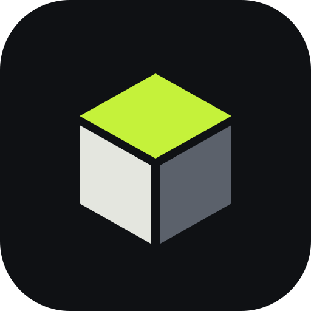
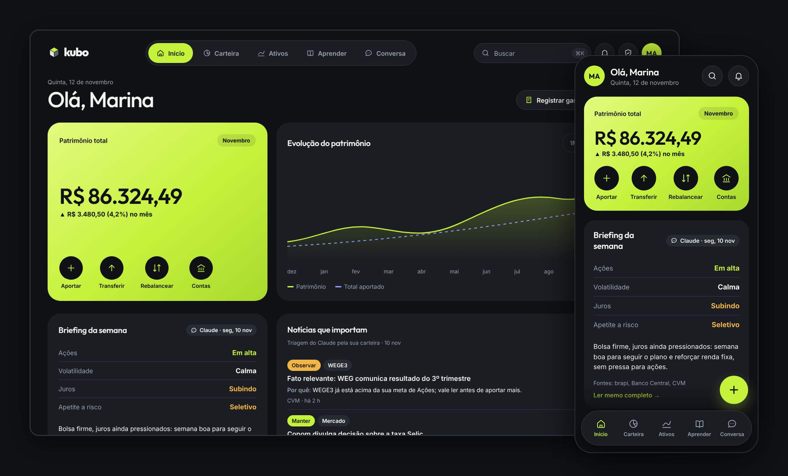
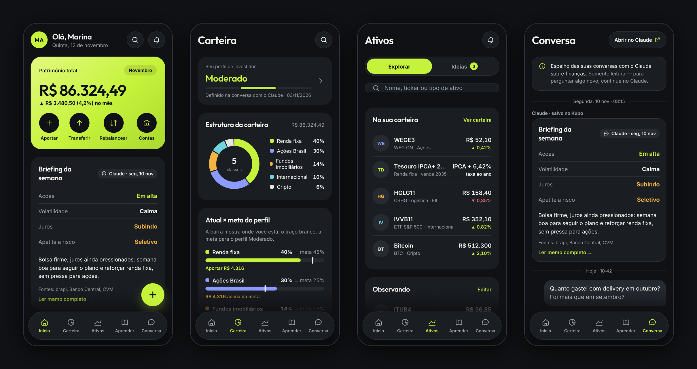
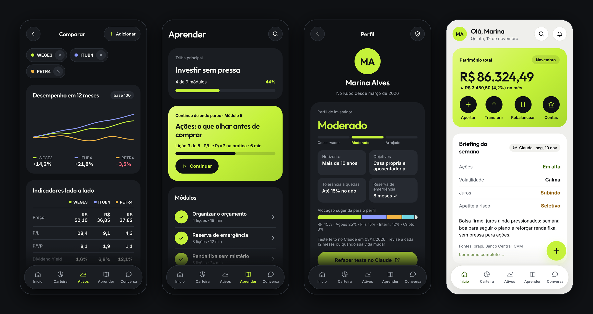
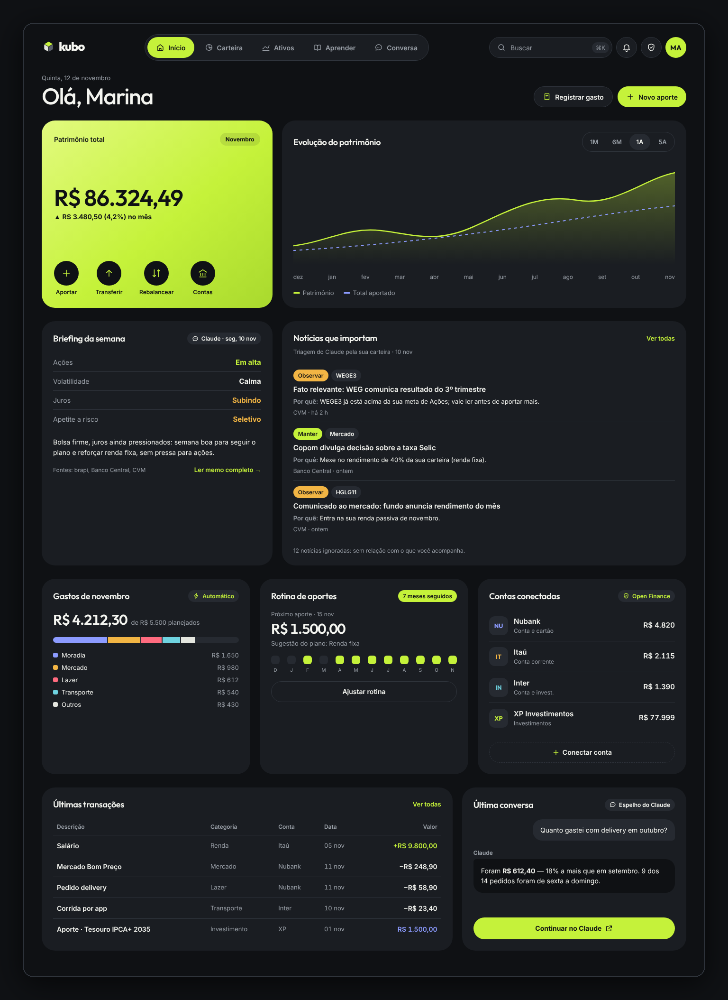
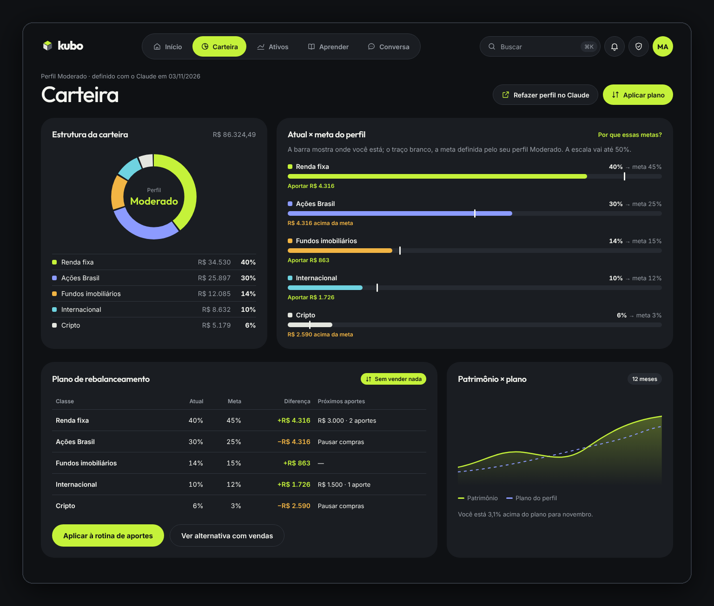
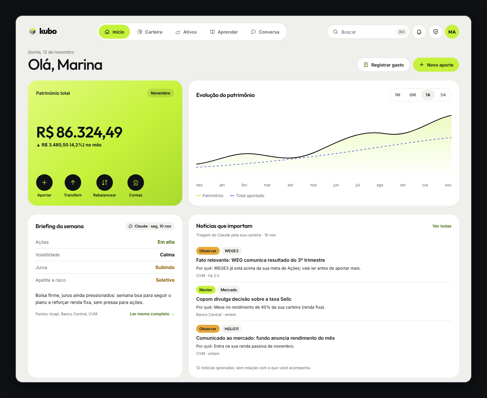
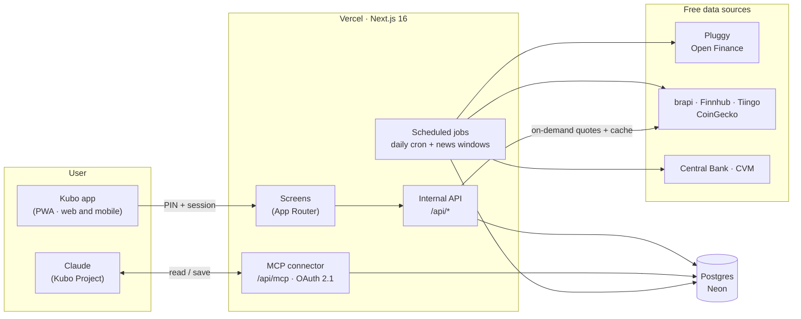

<div align="center">



# Kubo

**A personal finance app with an AI analyst built in.**
Portfolio, spending and monthly contributions in one place, with Claude reading the data and writing back briefings, memos and ideas to research.


<br>

[](README.md)
[](README.pt-BR.md)

</div>

<br>



> Screenshots come from the high-fidelity prototype and use fictional data. The interface is in Brazilian Portuguese.

## Contents

- [About](#about)
- [Highlights](#highlights)
- [Screens](#screens)
- [Architecture](#architecture)
- [Claude integration (MCP)](#claude-integration-mcp)
- [Engineering decisions](#engineering-decisions)
- [Stack and data sources](#stack-and-data-sources)
- [Design](#design)
- [Status and roadmap](#status-and-roadmap)
- [Author](#author)

## About

Kubo started with a problem of my own: my money was spread across a bank account, credit cards, a Brazilian brokerage, a US account and crypto, and no app brought it all together **and** helped me think it through.

It does three things:

1. **Brings the data together.** Bank accounts and cards come in through Open Finance; quotes from B3 (the Brazilian exchange), US markets and crypto, Central Bank indicators and CVM (Brazil's SEC) filings arrive through scheduled jobs.
2. **Organizes it.** Net worth, portfolio allocation versus the investor profile's targets, spending by category, recurring bills and a contribution routine.
3. **Talks to the AI.** The server itself is an MCP connector: Claude reads the portfolio and the market, then saves back to the app the weekly briefing, news triage, asset memos and ideas for the next contribution.

One rule runs through the whole product: **Kubo never tells you to buy or sell.** It lays out facts, risks and open questions, always with a source and a date; the decision stays with the user.

And one design constraint: **zero cost**. Everything runs on free tiers, which shaped much of the engineering (see [Engineering decisions](#engineering-decisions)).

## Highlights

| | |
|---|---|
| 🧠 **Built-in AI analyst** | Custom MCP server with 14 tools (8 read, 6 write) and OAuth 2.1 with PKCE |
| 🏦 **Open Finance** | Accounts and cards synced through Pluggy, with OFX/CSV import as a fallback |
| 📊 **Multi-market portfolio** | Brazilian stocks, REITs, ETFs, treasury bonds, US assets and crypto in one view, with a rebalancing plan that uses **only new contributions**, no selling |
| 🧾 **Spending that makes sense** | Rename and recategorize transactions ("PIX to John" becomes "Soccer") with an "apply to all" rule; card bill payments, transfers and investments don't count as spending |
| 📰 **Triaged news** | CVM material facts and US news sorted into *keep / watch / ignore*, each with a reason tied to the portfolio |
| 📚 **Learning tracks** | 6 short tracks on budgeting, emergency funds, fixed income, stocks and more |
| 🔒 **Secure by default** | PIN with progressive lockout, API keys only on the server, profile photo and data behind a session |
| 📱 **PWA** | Installable on the phone, dark and light themes, privacy mode that hides amounts |

## Screens

### Mobile



<sub>Home · Portfolio · Assets · Conversation</sub>



<sub>Compare · Learn · Profile · Home in light theme</sub>

### Web

<table>
  <tr>
    <td width="50%"></td>
    <td width="50%"><br><br></td>
  </tr>
  <tr>
    <td align="center"><sub>Home: net worth, briefing, news, spending and contributions</sub></td>
    <td align="center"><sub>Portfolio (current × target and rebalancing) and Home in light theme</sub></td>
  </tr>
</table>

## Architecture



**How the server is organized**

```
app/                 screens (App Router) and API routes
  api/mcp/           Claude connector
  api/oauth/         dynamic registration, authorization, token and revocation (OAuth 2.1)
  api/cron/diario/   daily data collection
src/
  domain/            pure rules: portfolio and contribution plan, spending and rename rules, market overview
  sources/           API clients (brapi, Finnhub, Tiingo, CoinGecko, Central Bank, CVM, Pluggy)
  services/          use cases shared by the screens and the connector
  mcp/               tool definitions and authentication
  jobs/              collection jobs (each step isolated: if one source fails, the others keep going)
  db/                Drizzle schema
drizzle/             SQL migrations (applied automatically on every deploy)
tests/               tests with an in-memory Postgres, no internet needed
```

## Claude integration (MCP)

Kubo exposes a [Model Context Protocol](https://modelcontextprotocol.io) server at `/api/mcp`. Inside a Claude Project, short commands become complete workflows:

| Command in Claude | What happens |
|---|---|
| **"weekly briefing"** | Reads market overview, news and portfolio → triages each news item → saves a market map + summary with sources |
| **"analyze WEGE3"** | Reads the position and dividends, researches official sources → saves a 4-part memo: data · strengths and weaknesses · what could change · what we don't know |
| **"ideas for the contribution"** | Compares the portfolio with the profile's targets → saves 2 to 4 ideas *to research*, each with its main risk, an open question and an expiry date |
| **"redo profile"** | Runs the investor profile questionnaire → saves the profile and per-class targets (adding up to 100%) |

<details>
<summary><b>The connector's 14 tools</b></summary>

| Read | Write |
|---|---|
| `kubo_resumo_carteira` positions, value and allocation | `kubo_salvar_briefing` market map and summary |
| `kubo_plano_aportes` gaps and a no-selling plan | `kubo_salvar_triagem` keep / watch / ignore |
| `kubo_gastos_mes` summary, recurring bills and transactions | `kubo_salvar_memo` asset memo (exactly 4 parts) |
| `kubo_aportes` contributions this year | `kubo_salvar_ideias` ideas to research |
| `kubo_panorama_mercado` Ibovespa, S&P 500, Selic, USD/BRL, IPCA | `kubo_salvar_perfil` profile and targets (sum to 100%) |
| `kubo_noticias` CVM and Finnhub news for tracked assets | `kubo_salvar_resposta` answer for the Conversation tab |
| `kubo_proventos` dividends and REIT distributions | |
| `kubo_perfil_atual` profile and targets | |

</details>

The app never reads Claude's chat history: it only shows what Claude **saved** through the connector, always with a date and an expiry. The *Conversation* tab mirrors those answers, with a button to continue in Claude.

## Engineering decisions

- **Zero cost as a requirement.** Vercel Hobby, Neon Free and only APIs with a free tier. When a limit is hit, these plans refuse instead of charging; the app handles `429` with `Retry-After`, caching and a notice in the UI.
- **Caching by market.** B3 quotes are cached for 15 min, US quotes for 1 min, and 6 h outside trading hours. The free brapi tier allows 1 symbol and 1 request at a time, so calls run sequentially.
- **Resilient jobs.** The daily cron runs isolated steps (Central Bank, quotes, price history, news, dividends) and records the result of each; one source going down doesn't take the others with it. A cleanup job keeps the database under 1 GB.
- **OAuth 2.1 connector.** Dynamic client registration, PKCE and tokens stored only as hashes, so it works with Claude's custom connectors without relying on a fixed header.
- **PIN access.** 5 wrong attempts lock the app for 15 min, and each new lockout doubles the wait (up to 24 h); 30-day sessions and an idle lock.
- **User edits win.** Renaming or recategorizing a transaction is never overwritten by the next Open Finance sync.
- **Domain separated from infrastructure.** Portfolio, rebalancing and spending rules are pure functions in `src/domain`, tested without a database or network.
- **Tests without internet.** Over 60 tests with Vitest and an in-memory Postgres (PGlite), including the MCP connector end to end and data sources with recorded responses.
- **Official sources first.** Central Bank indicators, CVM filings and SEC data; unofficial endpoints (such as Yahoo Finance) were dropped.

## Stack and data sources

| Layer | Technology |
|---|---|
| Front end and API | Next.js 16 (App Router), React 19, TypeScript |
| Database | Postgres (Neon) with Drizzle ORM and automatic migrations on deploy |
| AI | MCP server (`mcp-handler` + MCP SDK), used by Claude |
| Hosting | Vercel (daily cron) + GitHub Actions (news windows) |
| Tests | Vitest + PGlite |

| Data | Source |
|---|---|
| B3 stocks, REITs, ETFs and BDRs, dividends | brapi.dev |
| US quotes and news | Finnhub |
| US price history | Tiingo |
| Crypto | CoinGecko |
| Selic, CDI, IPCA, USD/BRL | Central Bank of Brazil (SGS) |
| Material facts and announcements | CVM Open Data |
| Accounts, cards and transactions | Pluggy (Open Finance) + OFX/CSV |

## Design

The visual identity was created alongside the product: an isometric cube as the logo and the **Graphite & Lime** palette, built so financial figures can be read at a glance.

| Color | Use |
|---|---|
|  `#0F1114` Graphite | Background |
|  `#1A1D22` Charcoal | Cards |
|  `#C5F23A` Lime | Primary action and positive values |
|  `#FF6B7F` Coral | Negative values and spending |
|  `#8C9BFF` Lavender | Second chart series |
|  `#F2B544` Amber | Targets and warnings |

Typography is **Outfit** (headings and balances) and **Inter** (interface, with tabular figures). Cards with 24 to 32 px corners, pills, circular action buttons and smooth area charts. The light theme has contrast tuned for accessibility.

## Status and roadmap

Kubo is in daily use as a personal app (single user), in production on Vercel.

- [x] PIN access and Claude connector with OAuth 2.1
- [x] Cached quotes, scheduled jobs and automatic cleanup
- [x] Open Finance (Pluggy) and OFX/CSV import
- [x] Screens: Home, Portfolio, Assets, Asset analysis, Compare, Spending, Recurring bills, Contributions, Learn, Conversation and Profile
- [ ] CVM financial statements (DFP/ITR) and peer comparison in the memo
- [ ] Brazilian Treasury Direct data
- [ ] Public demo with fictional data

> The source code lives in a private repository because the app stores real financial data. I'm happy to walk through the code and a demo with fictional data in a call.

## Author

Built by **Carlos** · [GitHub](https://github.com/cxrlos99leonel)
