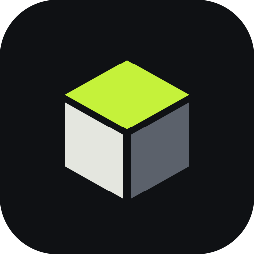
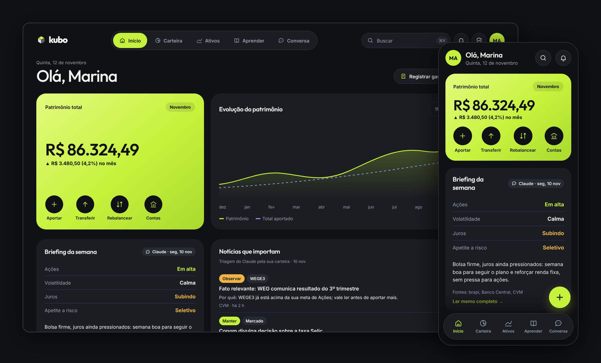
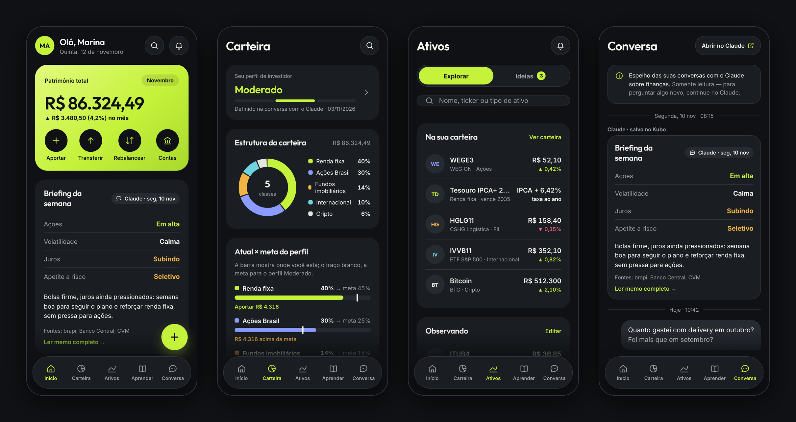
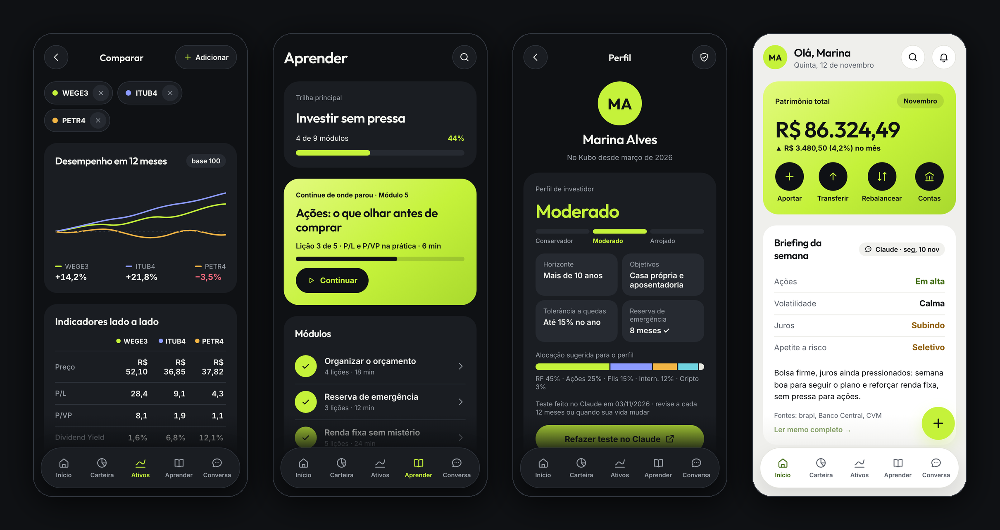
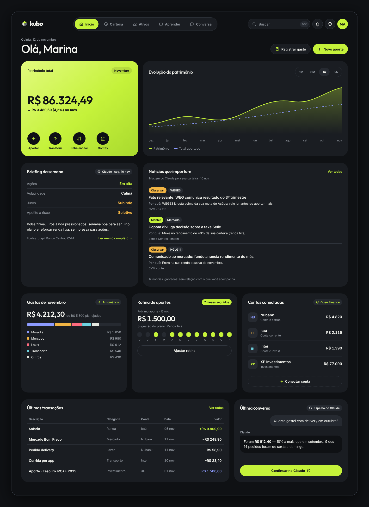
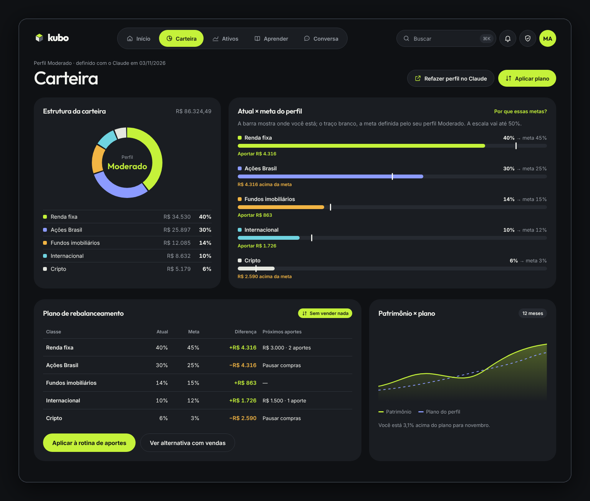
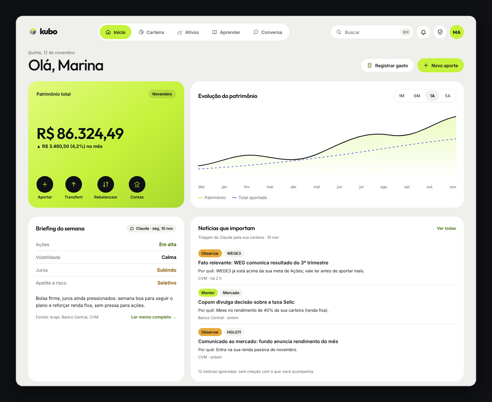
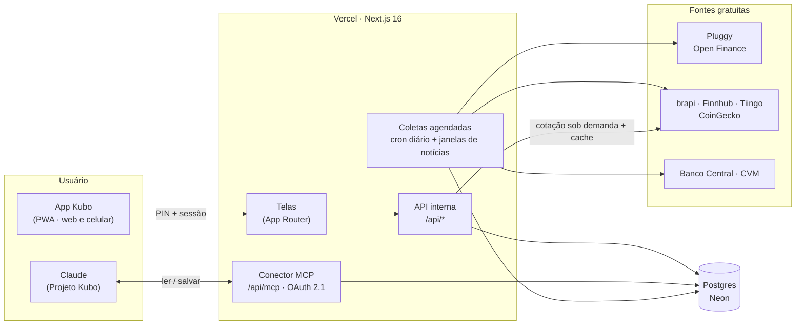

<div align="center">



# Kubo

**App de finanças pessoais com um analista de IA dentro.**
Carteira, gastos e aportes em um só lugar, com o Claude lendo os dados e devolvendo briefings, memos e ideias para estudar.


<br>

[](README.md)
[](README.pt-BR.md)

</div>

<br>



> As imagens são do protótipo de alta fidelidade e usam dados fictícios.

## Sumário

- [Sobre o projeto](#sobre-o-projeto)
- [Destaques](#destaques)
- [Telas](#telas)
- [Arquitetura](#arquitetura)
- [Integração com o Claude (MCP)](#integração-com-o-claude-mcp)
- [Decisões de engenharia](#decisões-de-engenharia)
- [Stack e fontes de dados](#stack-e-fontes-de-dados)
- [Design](#design)
- [Status e próximos passos](#status-e-próximos-passos)
- [Autor](#autor)

## Sobre o projeto

O Kubo nasceu de um problema meu: o dinheiro estava espalhado entre banco, cartões, corretora brasileira, conta nos EUA e cripto, e nenhum app juntava tudo **e** ajudava a pensar sobre isso.

Ele faz três coisas:

1. **Junta os dados.** Contas e cartões chegam pelo Open Finance; cotações da B3, dos EUA e de cripto, indicadores do Banco Central e comunicados da CVM chegam por coletas automáticas.
2. **Organiza.** Patrimônio, estrutura da carteira contra a meta do perfil, gastos por categoria, gastos fixos e rotina de aportes.
3. **Conversa com a IA.** O próprio servidor é um conector MCP: o Claude lê a carteira e o mercado e salva de volta no app o briefing da semana, a triagem das notícias, memos de ativos e ideias para o próximo aporte.

Uma regra atravessa o produto inteiro: **o Kubo nunca dá ordem de compra ou venda.** Ele organiza fatos, riscos e o que ainda está em aberto, sempre com fonte e data; a decisão fica com a pessoa.

E uma restrição de projeto: **custo zero**. Tudo roda em planos gratuitos, o que moldou boa parte da engenharia (veja [Decisões de engenharia](#decisões-de-engenharia)).

## Destaques

| | |
|---|---|
| 🧠 **Analista de IA integrado** | Servidor MCP próprio com 14 ferramentas (8 de leitura, 6 de escrita) e OAuth 2.1 com PKCE |
| 🏦 **Open Finance** | Contas e cartões sincronizados via Pluggy, com importação OFX/CSV como plano B |
| 📊 **Carteira multimercado** | Ações, FIIs, ETFs, Tesouro, ativos dos EUA e cripto em uma visão só, com plano de rebalanceamento **só com aportes**, sem vender |
| 🧾 **Gastos que fazem sentido** | Renomear e recategorizar lançamentos ("PIX p/ fulano" vira "Futebol") com regra "aplicar a todos"; fatura, transferências e aplicações não contam como gasto |
| 📰 **Notícias com triagem** | Fatos relevantes da CVM e notícias dos EUA classificadas em *manter / observar / ignorar*, com o motivo ligado à carteira |
| 📚 **Trilhas de aprendizado** | 6 trilhas curtas sobre orçamento, reserva, renda fixa, ações e mais |
| 🔒 **Seguro por padrão** | PIN com bloqueio progressivo, chaves só no servidor, foto e dados atrás de sessão |
| 📱 **PWA** | Instalável no celular, tema escuro e claro, modo privacidade que esconde valores |

## Telas

### Celular



<sub>Início · Carteira · Ativos · Conversa</sub>



<sub>Comparar · Aprender · Perfil · Início no tema claro</sub>

### Web

<table>
  <tr>
    <td width="50%"></td>
    <td width="50%"><br><br></td>
  </tr>
  <tr>
    <td align="center"><sub>Início: patrimônio, briefing, notícias, gastos e aportes</sub></td>
    <td align="center"><sub>Carteira (atual × meta e rebalanceamento) e Início no tema claro</sub></td>
  </tr>
</table>

## Arquitetura



**Como o servidor está organizado**

```
app/                 telas (App Router) e rotas de API
  api/mcp/           conector do Claude
  api/oauth/         registro dinâmico, autorização, token e revogação (OAuth 2.1)
  api/cron/diario/   coleta diária
src/
  domain/            regras puras: carteira e plano de aportes, gastos e regras de renomear, panorama
  sources/           clientes das APIs (brapi, Finnhub, Tiingo, CoinGecko, BCB, CVM, Pluggy)
  services/          casos de uso usados pelas telas e pelo conector
  mcp/               definição das ferramentas e autenticação
  jobs/              coletas (cada etapa isolada: se uma fonte cai, as outras seguem)
  db/                schema Drizzle
drizzle/             migrações SQL (aplicadas sozinhas a cada deploy)
tests/               testes com Postgres em memória, sem internet
```

## Integração com o Claude (MCP)

O Kubo expõe um servidor [Model Context Protocol](https://modelcontextprotocol.io) em `/api/mcp`. Dentro de um Projeto no Claude, comandos simples viram fluxos completos:

| Comando no Claude | O que acontece |
|---|---|
| **"briefing da semana"** | Lê panorama, notícias e carteira → classifica cada notícia → salva mapa do mercado + resumo com fontes |
| **"analisa WEGE3"** | Lê posição e proventos, pesquisa fontes oficiais → salva um memo em 4 partes: dados · ponto forte e fraco · o que pode mudar · o que não sabemos |
| **"ideias para o aporte"** | Compara carteira com as metas do perfil → salva 2 a 4 ideias *para estudar*, cada uma com risco principal, pergunta em aberto e validade |
| **"refazer perfil"** | Conduz o teste de perfil de investidor → salva perfil e metas por classe (somando 100%) |

<details>
<summary><b>As 14 ferramentas do conector</b></summary>

| Leitura | Escrita |
|---|---|
| `kubo_resumo_carteira` posições, valor e distribuição | `kubo_salvar_briefing` mapa do mercado e resumo |
| `kubo_plano_aportes` lacunas e plano sem vender | `kubo_salvar_triagem` manter / observar / ignorar |
| `kubo_gastos_mes` resumo, fixos e transações | `kubo_salvar_memo` memo de ativo (exatamente 4 partes) |
| `kubo_aportes` aportes do ano | `kubo_salvar_ideias` ideias para estudar |
| `kubo_panorama_mercado` Ibovespa, S&P 500, Selic, dólar, IPCA | `kubo_salvar_perfil` perfil e metas (somam 100%) |
| `kubo_noticias` CVM e Finnhub dos ativos acompanhados | `kubo_salvar_resposta` resposta para a aba Conversa |
| `kubo_proventos` dividendos, JCP e rendimentos | |
| `kubo_perfil_atual` perfil e metas | |

</details>

O app nunca lê o histórico do Claude: ele só mostra o que o Claude **salvou** pelo conector, sempre com data e validade. A aba *Conversa* é um espelho dessas respostas, com um botão para continuar no Claude.

## Decisões de engenharia

- **Custo zero como requisito.** Vercel Hobby, Neon Free e só APIs com plano gratuito. Quando um limite estoura, esses planos recusam em vez de cobrar; o app trata `429` com `Retry-After`, cache e aviso na interface.
- **Cache por tipo de mercado.** Cotações da B3 ficam 15 min em cache, dos EUA 1 min, e 6 h fora do pregão. A brapi gratuita aceita 1 ativo e 1 requisição por vez, então as chamadas são feitas em sequência.
- **Coletas resilientes.** O cron diário roda etapas isoladas (Banco Central, cotações, históricos, notícias, proventos) e grava o resultado de cada uma; uma fonte fora do ar não derruba as outras. Uma rotina de limpeza mantém o banco dentro de 1 GB.
- **Conector com OAuth 2.1.** Registro dinâmico de cliente, PKCE e tokens guardados só como hash, para funcionar com conectores personalizados do Claude sem depender de cabeçalho fixo.
- **Acesso por PIN.** 5 erros bloqueiam por 15 min, e cada novo bloqueio dobra o tempo (até 24 h); sessão de 30 dias e bloqueio por inatividade.
- **A edição do usuário vence.** Renomear ou recategorizar um lançamento nunca é sobrescrito pela próxima sincronização do Open Finance.
- **Domínio separado da infraestrutura.** As regras de carteira, rebalanceamento e gastos são funções puras em `src/domain`, testadas sem banco nem rede.
- **Testes sem internet.** Mais de 60 testes com Vitest e Postgres em memória (PGlite), incluindo o conector MCP ponta a ponta e as fontes com respostas gravadas.
- **Fontes oficiais primeiro.** Indicadores do Banco Central, comunicados da CVM e filings da SEC; endpoints não oficiais (como Yahoo Finance) foram descartados.

## Stack e fontes de dados

| Camada | Tecnologia |
|---|---|
| Front-end e API | Next.js 16 (App Router), React 19, TypeScript |
| Banco | Postgres (Neon) com Drizzle ORM e migrações automáticas no deploy |
| IA | Servidor MCP (`mcp-handler` + MCP SDK), consumido pelo Claude |
| Hospedagem | Vercel (cron diário) + GitHub Actions (janelas de notícias) |
| Testes | Vitest + PGlite |

| Dado | Fonte |
|---|---|
| Ações, FIIs, ETFs e BDRs da B3, proventos | brapi.dev |
| Cotações e notícias dos EUA | Finnhub |
| Histórico dos EUA | Tiingo |
| Cripto | CoinGecko |
| Selic, CDI, IPCA, dólar | Banco Central (SGS) |
| Fatos relevantes e comunicados | CVM Dados Abertos |
| Contas, cartões e transações | Pluggy (Open Finance) + OFX/CSV |

## Design

A identidade visual foi criada junto com o produto: um cubo isométrico como marca e a paleta **Grafite & Lima**, pensada para valores financeiros lidos de relance.

| Cor | Uso |
|---|---|
|  `#0F1114` Grafite | Fundo |
|  `#1A1D22` Carvão | Cartões |
|  `#C5F23A` Lima | Ação principal e valores positivos |
|  `#FF6B7F` Coral | Negativos e gastos |
|  `#8C9BFF` Lavanda | Segunda série dos gráficos |
|  `#F2B544` Âmbar | Metas e avisos |

Tipografia em **Outfit** (títulos e saldos) e **Inter** (interface, com algarismos tabulares). Cartões com cantos de 24 a 32 px, pílulas, botões de ação circulares e gráficos de área com curva suave. Tema claro com contraste revisado para acessibilidade.

## Status e próximos passos

O Kubo está em uso diário como app pessoal (um único usuário), em produção na Vercel.

- [x] Acesso por PIN e conector do Claude com OAuth 2.1
- [x] Cotações com cache, coletas agendadas e limpeza automática
- [x] Open Finance (Pluggy) e importação OFX/CSV
- [x] Telas: Início, Carteira, Ativos, Análise do ativo, Comparar, Gastos, Gastos fixos, Aportes, Aprender, Conversa e Perfil
- [ ] Demonstrações da CVM (DFP/ITR) e comparação com concorrentes no memo
- [ ] Dados do Tesouro Direto
- [ ] Versão de demonstração pública com dados fictícios

> O código-fonte fica em um repositório privado porque o app guarda dados financeiros reais. Posso mostrar o código e uma demonstração com dados fictícios em uma conversa.

## Autor

Feito por **Carlos** · [GitHub](https://github.com/cxrlos99leonel)
